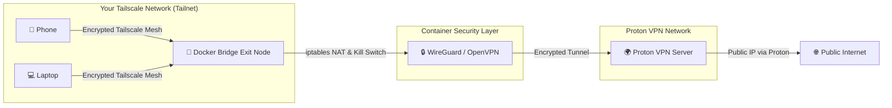

[](https://buymeacoffee.com/alexandre1116)

# Proton VPN to Tailscale Bridge Exit Node

**English** | [Português](README.pt.md)

[](https://www.docker.com/)
[](https://opensource.org/licenses/MIT)
[](https://tailscale.com)
[](https://protonvpn.com)
[](#)

Current release: [`v0.2.1`](https://github.com/Alexandre1116/tailscale-proton-bridge/releases/tag/v0.2.1)

Route all your private Tailscale network traffic through **Proton VPN** (including the **100% Free tier**) via a lightweight Docker exit node.

Whenever any device on your Tailnet (smartphone, laptop, tablet) connects to this Exit Node, its internet traffic is routed through Proton VPN servers.



---

## Features

- **WireGuard & OpenVPN Support**: Optimized for WireGuard (faster speed, minimal CPU usage) with full OpenVPN fallback.
- **Works with Proton VPN Free**: No paid plan required. Supports Proton VPN Free tier server configurations.
- **Forwarding kill switch**: Drops forwarded traffic unless it uses the VPN interface. Validate DNS and IPv6 behaviour on the client you use.
- **Non-Privileged Container**: Operates without `privileged: true`, using only minimum Linux capabilities (`NET_ADMIN`, `NET_RAW`).
- **Interactive Web UI**: Modern web dashboard with drag-and-drop file upload, setup wizard, and real-time status monitoring.
- **Interactive Setup CLI**: Guided terminal wizard (`python setup.py`) to configure your environment in seconds.
- **Multi-Architecture**: Out-of-the-box support for `amd64` (x86_64 PCs & servers) and `arm64` (Raspberry Pi 4/5, Synology NAS, Apple Silicon).
- **Native Healthchecks**: Docker health checks monitoring Tailscale daemon and VPN interface connectivity.

This beta is intended for validation on the compatibility targets below. Test
the VPN-down fail-closed behaviour before using the bridge for production
traffic.

---

## Prerequisites

1. **Proton VPN Account** (Free or Paid tier).
2. **Tailscale Account** with access to the Tailscale admin console.
3. **Docker & Docker Compose** installed on your host (Linux PC, Server, Synology/QNAP NAS, or Raspberry Pi).

---

## Quick Start (CLI Wizard)

An interactive Python setup script is included to automatically create directories, configure `.env`, and start the containers:

```bash
python setup.py
```

Follow the prompts on your terminal. If you prefer manual setup, follow the guide below.

---

## Manual Step-by-Step Setup

### Step 1: Clone Repository & Prepare Directories

```bash
git clone https://github.com/Alexandre1116/tailscale-proton-bridge.git
cd tailscale-proton-bridge
```

The directories `./vpn/wireguard` and `./vpn/openvpn` are pre-tracked in Git.

---

### Step 2: Download Proton VPN Configuration

#### Option A: WireGuard (Recommended)
1. Sign in to [account.protonvpn.com](https://account.protonvpn.com).
2. Go to **Downloads** -> **WireGuard configuration**.
3. Choose a configuration name, select platform **Linux**, enable **VPN Accelerator**, and pick a server (e.g. Free server).
4. Click **Create** and **Download** the `.conf` file.
5. Save or rename the downloaded file to:
   ```
   ./vpn/wireguard/protonvpn.conf
   ```

#### Option B: OpenVPN (Alternative)
1. In [account.protonvpn.com](https://account.protonvpn.com), go to **Downloads** -> **OpenVPN configuration files**.
2. Select **Linux**, **UDP**, and download a server profile.
3. Save or rename it to:
   ```
   ./vpn/openvpn/protonvpn.ovpn
   ```
4. On the same downloads page, copy your **OpenVPN / IKEv2 username and password** (these are different from your regular login credentials). Either:
   - Put them in `.env` (`PROTONVPN_USER` and `PROTONVPN_PASSWORD`), **OR**
   - Save them to `./vpn/openvpn/credentials.txt` (username on line 1, password on line 2).

---

### Step 3: Configure `.env`

Copy the template file:
```bash
cp .env.example .env
```

Edit `.env` with your settings:
- **`TS_AUTHKEY`**: Generated in Tailscale Admin Console (**Settings -> Keys -> Generate Auth Key**). For a long-lived bridge, use a reusable, pre-authorized key. Leave blank to authenticate via the login URL shown in the logs and Web UI.
- **`VPN_TYPE`**: `wireguard`, `openvpn`, or `auto` (auto-detects configuration file).
- **`TS_HOSTNAME`**: Name for your device on your Tailnet (default: `protonvpn-bridge`).
- **`WEBUI_USERNAME`** & **`WEBUI_PASSWORD`**: Required credentials for the Web UI. The Web UI refuses to start with an empty password.

---

### Step 4: Build & Launch Container

```bash
docker compose up -d --build
```

View live container logs:
```bash
docker compose logs -f
```

---

### Step 5: Approve Exit Node in Tailscale

Tailscale requires manual admin approval for nodes advertising as exit nodes:

1. Open your [Tailscale Admin Console](https://login.tailscale.com/admin/machines).
2. Find your node (e.g., `protonvpn-bridge`).
3. Click the **three dots (...)** next to the machine and choose **Edit route settings**.
4. Check **Use as exit node** and click **Save**.

Your Proton VPN Exit Node is now live!

---

## Web UI Dashboard

A lightweight web dashboard is available at the configured bind address and
port, for example `http://<host-ip>:8080`:

1. **Authentication**: Uses HTTP Basic Auth (`WEBUI_USERNAME` and `WEBUI_PASSWORD`). `WEBUI_PASSWORD` must be set before starting the Web UI.
2. **First Run Wizard**: Automatically launches a 4-step wizard with drag-and-drop file upload for `.conf` or `.ovpn` files.
3. **Manual Login Link**: If no `TS_AUTHKEY` is provided, a clickable login link appears dynamically in the header.
4. **Apply changes**: Use **Save and apply** for Website routing and VPN exclusions. To apply other changes that affect container configuration, recreate the services:
   ```bash
   docker compose up -d --build vpn-tailscale-bridge webui
   ```

### Multiple exit nodes and locations

The Web UI can create multiple Proton VPN profiles in the same bridge. Exit-node
profiles have their own Tailscale identity, hostname, and VPN interface.
A WireGuard profile with **Routing only** enabled provides a VPN interface
and routing table for Website routing. It uses no Tailscale identity or device
slot. Profiles without this setting continue to advertise as exit nodes.

To add an exit node, use **Add profile**, upload the Proton WireGuard or
OpenVPN file, and provide a reusable Tailscale auth key. Restart the bridge to
load profile changes:

```bash
docker compose restart vpn-tailscale-bridge
```

Profiles are stored under `./vpn/profiles/<id>/`. Only exit-node profiles count
toward the tailnet device limit. Multi-profile mode is enabled by default.
Set `MULTI_PROFILE_ENABLED=0` to keep using the legacy single-profile configuration.

When at least one valid exit-node profile exists, the legacy files under `./vpn/wireguard`, `./vpn/openvpn`, and the legacy VPN values in `.env` are ignored by the bridge.
The dashboard also shows the number of devices with active forwarded sessions through the exit node. This count comes from the bridge's connection tracking table, so it represents devices observed recently by the data plane, not every device that has selected the exit node while idle.
5. **Updates**: The dashboard reads the latest stable GitHub release, shows an alert when one is available, and offers one-click installation. Enable automatic updates and choose a local host time for the daily check. The updater installs the release and rebuilds the application services.

### Profile directory permissions

The Web UI creates and updates profiles in the host directory `./vpn/profiles`.
If Docker created that directory as root, the Web UI can read it but cannot
create profiles or save website routing. From the project directory on the
Docker host, give the directory to the Web UI's user (UID 100 and GID 101 in the
default image):

```bash
webui_owner=$(sudo docker compose exec -T webui sh -c 'printf "%s:%s" "$(id -u)" "$(id -g)"')
sudo chown "$webui_owner" ./vpn/profiles
sudo chmod u+rwx ./vpn/profiles
```

If editing an existing profile still fails, check the ownership of that
profile's own directory and files. Keep private VPN keys restricted to their
owner. The permission change takes effect immediately through the bind mount.

### Updater setup

The updater runs as a separate service. Only it has access to the Docker socket,
while the Web UI communicates through `./updater/state`. On Linux or Synology,
set the absolute project path in `.env` so Docker Compose can resolve build and
bind-mount paths from the updater container:

```dotenv
APP_VERSION=v0.2.1
GITHUB_REPOSITORY=Alexandre1116/tailscale-proton-bridge
AUTO_UPDATE_ENABLED=0
AUTO_UPDATE_HOUR=03:00
UPDATE_HOST_PROJECT_PATH=/volume1/docker/tailscale-proton-bridge
```

Start all services with `docker compose up -d --build`. With automatic updates
disabled, use **Check now** and **Install available update** in the dashboard.
The updater refuses to install over local Git changes, and refuses to run when
`UPDATE_HOST_PROJECT_PATH` is empty or differs from the mounted path.

### Docker inside an LXC container (Proxmox)

If the bridge fails to start under Docker-in-LXC because of AppArmor, set
`BRIDGE_SECURITY_OPT=apparmor=unconfined` in `.env` instead of editing
`docker-compose.yml`. Local edits block the updater.

Inside an LXC, `/proc/sys` is read-only for containers and some kernel
resources are restricted, so tailscaled logs warnings that need no action:
`failed to enable src_valid_mark` (Compose's `sysctls:` already set the value),
`failed to force-set UDP ... buffer size` (affects throughput only), and
`peerapi ... bind: cannot assign requested address` (IPv6 is disabled by
design). They are not tunnel failures.

### DNS and health probe resilience

In single-profile mode the bridge writes the Proton tunnel's DNS servers and
fallback resolvers (`DNS_FALLBACK_SERVERS`, default `1.1.1.1 9.9.9.9`, an
empty value disables them) into the container's `/etc/resolv.conf` (max
three nameservers; musl and c-ares ignore more). In OpenVPN mode the
fallbacks are appended to the resolvers already configured. Alpine's musl
resolver queries all listed servers in parallel, so a fallback answers as
soon as the tunnel's resolver stops replying. Those fallbacks only ever
carry the bridge's own lookups (health checks, tailscale's control-plane
names) and still leave through the VPN tunnel; Cloudflare and Quad9 do see
those lookups, so set `DNS_FALLBACK_SERVERS` to your own resolvers or an
empty value to opt out. Your Tailnet devices use whichever resolver they
configure. The fallbacks exist because a Proton DNS outage would otherwise
fail the bridge's own probes and restart the container in a loop. Health
probes try every URL in `VPN_HEALTHCHECK_URLS` (your `VPN_HEALTHCHECK_URL`
plus `checkip.amazonaws.com` and `ifconfig.me` by default; setting the list
replaces it entirely) before counting one failure, splitting
`HEALTHCHECK_BUDGET_SECONDS` (default 18s) across the URLs so neither the
monitor loop nor the Docker healthcheck (20s timeout) stalls on dead
endpoints. In multi-profile mode each profile's tunnel is verified instead
by probing through the profile's own interface.

### Website routing across WireGuard profiles

Add and connect your Proton WireGuard profiles in the dashboard. Under **Website
routing**, choose a **Default Proton profile**, add rules to send specific
hostnames through another profile or **Direct**, and click **Save and apply
routing**. The running bridge picks up the change during its next monitor
cycle and restarts in the same container. Active connections can be interrupted
briefly. The dashboard confirms when the updated routing is installed. Select
any of the bridge's exit nodes in Tailscale. The same rules apply whichever node
you select.

For example, choose USA as the default, route `example.org` through Ukraine, and
set `vinted.com,www.vinted.com` to Direct. Existing **VPN exclusions** also act
as Direct rules. You can configure the initial settings in `.env`:

```dotenv
VPN_ROUTING_DEFAULT=usa
VPN_ROUTING_RULES=example.org@ukraine,vinted.com@_direct,www.vinted.com@_direct
```

Once you apply changes from the dashboard, `vpn/profiles/.website-routing.env`
takes precedence over the three routing values from Compose. To switch back to
managing them in Compose, remove that file and recreate the bridge and Web UI
with your updated environment.

Use profile IDs (the directory names under `vpn/profiles`), and up to 20
hostnames in the routing rules. Clear the default to turn off website routing.
Public IPv4 addresses are refreshed from the bridge's DNS. If different rules
share an address, the dashboard shows the conflict and new connections use
the default profile. Existing connections keep their original egress for the
life of the connection. Traffic assigned to an unavailable tunnel is dropped.
A site can use a different IP on the client than the bridge resolves, in which
case its traffic follows the default. List country domains and subdomains
individually.

### One Tailscale exit node with two Proton WireGuard tunnels

1. Keep your existing named primary exit-node profile and its profile ID. If
   setting up fresh, add a WireGuard profile called **USA** and leave **Routing
   only** unchecked. Approve this device as an exit node in Tailscale Machines.
2. Add a **Ukraine** profile, enable **Routing only**, and upload the Ukraine
   Proton WireGuard `.conf`. Leave the Tailscale hostname and auth key unset.
   Restart the bridge to load the new tunnel, or continue to the next step and
   apply a changed routing configuration to trigger that restart.
3. Under **Website routing**, select **USA** as the default. Add hostnames
   such as `example.org` with **Ukraine** as the target, and keep
   `core.vinted.com` set to **Direct** here or in **VPN exclusions**. Click
   **Save and apply routing** and wait for the dashboard confirmation.
4. On your iPhone, select the **USA** exit node and leave it selected. You can
   also set **Ukraine** as the default without changing which exit node is
   selected on the phone.

If you convert an existing exit-node profile, the running bridge tries to
withdraw its advertisement before restarting. To remove its old device record,
open [Tailscale Machines](https://login.tailscale.com/admin/machines), locate the
old device, and select **Remove**. Keep your primary device and its persistent
Tailscale state volume. A standalone legacy install can keep using its existing
setup. This example uses a named exit-node profile in multi-profile mode.

To install the updated code once, run
`docker compose up -d --build vpn-tailscale-bridge webui`. No Compose or volume
changes are required. Subsequent website routing and exclusions changes use
**Save and apply** in the dashboard.

#### Verify the routes

- In Tailscale Machines, confirm the primary device retains its existing
  Tailscale IP and only the primary registers. In the dashboard, both VPN
  profiles should be connected. The routing-only profile has no Tailscale IP.
- With the same exit node selected on the iPhone, load three distinct IPv4
  IP-echo hostnames with separate DNS addresses. For example, leave
  `api.ipify.org` unmatched, temporarily route `checkip.amazonaws.com` through
  Ukraine, and temporarily route `ifconfig.me` through Direct. Use
  `https://ifconfig.me/ip` for the Direct check. Compare the results with the
  public IPs you get from each Proton connection and the bridge host's regular
  Internet connection. Keep `core.vinted.com` in the Direct rules.
- To verify fail-closed, temporarily take the secondary WireGuard interface
  down on the bridge. The test hostname assigned to Ukraine should fail on a
  new connection. Repeat the default and Direct checks to confirm they still
  reach their expected public IPs. Bring the secondary interface back up and
  wait for its dashboard state to recover.

### VPN exclusions

In the dashboard under **VPN exclusions**, enter up to 10 exact hostnames, such as
`vinted.com,www.vinted.com`, and select **Save and apply exclusions**.
This uses the same restart and dashboard confirmation as website routing.
For initial setup, you can also set
`VPN_BYPASS_DOMAINS=vinted.com,www.vinted.com` in `.env`.

Exclusions apply to every exit node and use the bridge host’s normal Internet
connection, exposing its public IP to the destination. The bridge periodically
resolves each hostname to public IPv4 addresses using its own DNS settings.
Forwarding works by IP, so other sites sharing those addresses also bypass
Proton VPN. If a client sees different DNS answers, its traffic may still use
Proton VPN. List subdomains and country-specific hostnames individually. The
Docker host needs kernel support for ipset when exclusions are enabled.

### Direct Tailscale connections

By default (`TS_DIRECT_UNDERLAY=1`), only tailscaled's own WireGuard UDP port
(`TS_PORT`, default `41641`) leaves through the local network. Exit node
traffic, DNS, the control plane and DERP still go through Proton VPN. Without
this, Proton's NAT forces every peer onto a DERP relay. Peers can see your
real public IP as a Tailscale endpoint; set `TS_DIRECT_UNDERLAY=0` if you
prefer to keep everything inside the tunnel.

---

## How to Use on Your Devices

1. Open the **Tailscale** client on your smartphone, tablet, or laptop.
2. Connect to your Tailnet.
3. Select **Exit Node** and choose `protonvpn-bridge`.
4. Check [ipinfo.io](https://ipinfo.io) or [dnsleaktest.com](https://dnsleaktest.com) to confirm your public IP and DNS reflect your chosen Proton VPN server.

---

## Security & Architecture Details

- **Minimal Privileges**: Runs with specific Linux capabilities (`NET_ADMIN` and `NET_RAW`) and `/dev/net/tun` rather than full `privileged: true`.
- **Forwarding kill switch**:
  - `iptables -P FORWARD DROP`: Default policy drops all routed packets. Packets are forwarded strictly through the VPN interface (`protonvpn` / `tun0`).
  - Container-level IPv6 disabling and `ip6tables -P FORWARD DROP` protect forwarded traffic. Validate DNS and IPv6 behaviour on the client you use.
- **Docker DNS Compatibility**: Transparently manages `/etc/resolv.conf` to avoid `openresolv` bind-mount collisions common in Docker environments.
- **Auto-Healing**: Monitors Tailscale, the VPN interface, and a real HTTPS request through the VPN. After consecutive failures, the container exits and Docker restarts it (`restart: unless-stopped`).
- **Image Scanning**: CI scans both images with Trivy. Critical findings fail the build; high-severity findings from upstream images remain visible in the scan output for review.

---

### Web UI transport and access

Configure these variables in `.env` before starting the containers:

```dotenv
WEBUI_USERNAME=admin
WEBUI_PASSWORD=choose-a-strong-password
WEBUI_PROTOCOL=http
WEBUI_ACCESS_MODE=all
WEBUI_BIND_ADDRESS=0.0.0.0
```

For HTTPS, put the certificate and key at `webui/certs/fullchain.pem` and
`webui/certs/privkey.pem`, then set `WEBUI_PROTOCOL=https`. The certificate
must match the hostname or IP used by the browser. A self-signed certificate
will show a browser warning and is not suitable for a public deployment.
The mounted certificate files must be readable by the Web UI container user (UID 100).

To restrict the published port to the Tailnet, set `WEBUI_ACCESS_MODE=tailnet`
and use the host's Tailscale IPv4 address:

```dotenv
WEBUI_ACCESS_MODE=tailnet
WEBUI_BIND_ADDRESS=100.101.102.103
```

For bridge credentials, create files under `secrets/` with permissions that
allow only the container user that needs them to read them, and use the file
variables instead of putting values in `.env`:

```dotenv
TS_AUTHKEY_FILE=/run/secrets/ts_authkey
PROTONVPN_USER_FILE=/run/secrets/protonvpn_user
PROTONVPN_PASSWORD_FILE=/run/secrets/protonvpn_password
WEBUI_PASSWORD_FILE=/run/secrets/webui_password
```

The bridge runs as root inside its container and can read its mounted secret
files. The Web UI runs as UID 100, so `webui_password` must be readable by
that UID. Never commit the `secrets/` directory contents.

The `tailnet` mode also allows the usual Tailscale IPv4 and IPv6 ranges. Binding
to a specific Tailscale IP is the stronger restriction. The Web UI writes VPN
credentials and `.env`, so do not publish this port directly to the Internet.

### Compatibility matrix

| Platform | Status | Notes |
|---|---|---|
| Debian/Ubuntu Linux with Docker Engine | Supported | Requires `/dev/net/tun`, IPv4/IPv6 forwarding, and network permissions. |
| Synology DSM 7.x with Container Manager | Supported with validation | Confirm `/dev/net/tun`, the available iptables backend, and the NAS architecture. |
| Raspberry Pi 4/5, 64-bit Raspberry Pi OS | Supported | CI covers `arm64`; test OpenVPN performance on the target model. |
| Docker Desktop on Windows/macOS | Bridge not supported | The UI may build, but the exit node needs the TUN device and Linux host networking. |

The integration test needs a second container running Tailscale. See
`tests/integration/test_exit_node.py` and set `TS_CLIENT_CONTAINER` and
`TS_EXIT_NODE` before running it.

The local checks are:

```bash
python -m pip install -r webui/requirements-dev.txt pip-audit
pytest -q
shellcheck entrypoint.sh healthcheck.sh webui/entrypoint.sh webui/healthcheck.sh
pip-audit -r webui/requirements.txt
```

## License

This project is open-source software licensed under the [MIT License](LICENSE).
